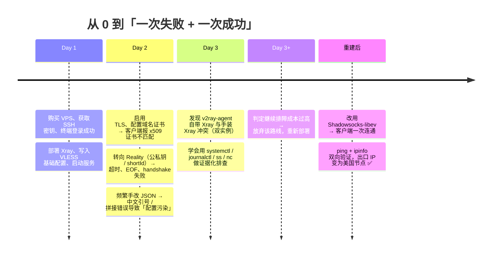

# VPN 原理与自建代理实验 · vpn-proxy-lab

> 一次从「照着教程抄配置」到「用证据定位问题」的完整学习记录：**先失败，再复盘，换方案，最后跑通。**

[](LICENSE)


[](https://github.com/Dean0928/vpn-proxy-lab/actions/workflows/ci.yml)

---

## 这是什么

这是一个**个人网络实验项目**的完整归档。它不是一份「五分钟搭好 VPN」的教程，而是把一次真实的实验过程摊开：

1. 我想搞清楚 VPN 到底是怎么工作的 —— 顺着原理写成了 [`docs/01`](docs/01-vpn-principles.md) 和 [`docs/02`](docs/02-protocol-comparison.md)；
2. 我先走了社区里最"高级"的那条路（Xray + VLESS + Reality），**连续三天没跑通**；
3. 我把失败过程做成时间线复盘（[`docs/05`](docs/05-xray-reality-postmortem.md)），并在成本收益上做了判断；
4. 换用更简单、更可控的 **Shadowsocks-libev** 方案，一次成功，并用 `ping` + `ipinfo` 双向验证；
5. 最后把踩过的坑沉淀成排障手册（[`docs/06`](docs/06-troubleshooting-playbook.md)）和一组可复用脚本（[`scripts/`](scripts/)）。

> **技术路线的"降级"不是退步。** 能判断"继续排障的成本已经高于换方案的收益"，本身就是这次实验最大的收获之一。

---

## 实验结果（可验证的部分）

| 项目 | 结果 | 证据 |
| --- | --- | --- |
| 服务端 | Vultr VPS · Debian 11 x64 · IPv4 | [截图](images/03-vultr-instance-running.png) |
| 服务端软件 | Shadowsocks-libev，`xchacha20-ietf-poly1305` | [安装输出](images/05-shadowsocks-server-install.png) |
| 客户端 | macOS + Shadowrocket（全局路由） | [节点列表](images/06-shadowrocket-node-list.png) |
| 连通性 | 出口 IP 由「本地 ISP」变为「Vultr 美国节点」 | [ipinfo 结果](images/07-ip-info-after-connect.png) |
| 链路质量 | `ping` RTT ≈ 170–260 ms，`ttl=48`，23 个包中 2 次超时（≈8.7% 丢包） | [ping 输出](images/04-ping-latency-test.png) |
| 失败路线 | Xray + VLESS + Reality：TLS 证书链 / Reality 参数 / 配置污染 / 双实例冲突，**未跑通** | [时间线复盘](images/08-failure-timeline-review.png) |

> 复现环境：Debian 11 服务端 + macOS 客户端。其它发行版需要自行替换包管理器命令。

---

## 学习时间线



每个阶段的**现象 → 根因 → 教训**都写在 [`docs/05-xray-reality-postmortem.md`](docs/05-xray-reality-postmortem.md) 里。

---

## 目录结构

```
vpn-proxy-lab/
├── README.md                     # 你正在看的这份：项目全貌 + 学习路径
├── docs/
│   ├── 01-vpn-principles.md      # VPN 是什么：加密隧道、工作流程、快递类比
│   ├── 02-protocol-comparison.md # VPN 协议 vs 代理协议（WireGuard / VLESS+Reality / SS）
│   ├── 03-wireguard-deep-dive.md # WireGuard 原理与最小可用部署（原理补充线）
│   ├── 04-shadowsocks-deployment.md # 本次成功路线的完整复现步骤
│   ├── 05-xray-reality-postmortem.md # ★ 失败路线复盘：8 个阶段的现象与根因
│   ├── 06-troubleshooting-playbook.md # ★ 排障手册：分层定位法 + 错误对照表
│   ├── 07-security-and-compliance.md  # 密钥/防火墙/SSH 加固 + 合规声明
│   └── 08-experiment-report.md   # 实验报告正文（脱敏后的 Markdown 版）
├── scripts/
│   ├── 01-server-hardening.sh    # 服务器初始化与 SSH 加固（幂等，可 --dry-run）
│   ├── 02-install-shadowsocks.sh # 安装并配置 shadowsocks-libev，自动生成 ss:// 链接
│   ├── 03-install-wireguard.sh   # WireGuard 服务端一键部署（原理对照用）
│   ├── 04-verify-connectivity.sh # 出口 IP / 延迟 / DNS 泄漏验证
│   └── ss-uri.py                 # 由配置生成 SIP002 格式 ss:// 分享链接
├── configs/                      # 全部为 *.example，占位符不含任何真实凭据
│   ├── shadowsocks-server.json.example
│   ├── wireguard-server-wg0.conf.example
│   ├── wireguard-client.conf.example
│   ├── xray-vless-reality.json.example
│   └── clash-verge-reality.yaml.example
├── tools/
│   ├── secret-scan.sh            # 发布前脱敏自查：私钥 / 公网 IP / ss:// 凭据 / 明文密码
│   └── check-links.py            # 检查 Markdown 相对链接是否有效
├── images/                       # 实验截图（IP / 端口 / 密码 / 域名 / UUID 全部打码）
└── .github/workflows/ci.yml      # 语法检查 + JSON 校验 + 脱敏自查 + 链接检查
```

---

## 快速开始（在有 sudo 权限的 Debian/Ubuntu 服务器上）

```bash
git clone https://github.com/Dean0928/vpn-proxy-lab.git
cd vpn-proxy-lab

# 0. 先看脚本会做什么（强烈建议先 dry-run）
sudo ./scripts/01-server-hardening.sh --dry-run

# 1. 服务器初始化 + SSH 加固（会提示确认）
sudo ./scripts/01-server-hardening.sh --apply

# 2. 安装 Shadowsocks-libev（不传 --password 时自动生成随机密码）
sudo ./scripts/02-install-shadowsocks.sh --port 8388 --method xchacha20-ietf-poly1305

# 3. 在本机验证（对比连接代理前后的出口 IP；端口以你客户端实际监听为准）
./scripts/04-verify-connectivity.sh --socks5 127.0.0.1:1080 --expect-node vultr
```

所有脚本都遵循三条约定：`set -euo pipefail`、**默认不破坏性执行**、凭据一律随机生成或从参数读取，绝不写死在仓库里。

---

## 我在这个实验里真正学到的东西

| 维度 | 从「不会」到「会」的具体表现 |
| --- | --- |
| Linux 服务管理 | 用 `systemctl enable/status`、`journalctl -u` 看服务状态和日志，而不是反复重装 |
| SSH 与远程运维 | 用密钥登录 VPS，理解 `sshd_config`、非 22 端口、防火墙放行的关系 |
| 网络分层 | 能说出「物理链路 → IP → TCP/UDP → TLS → 应用协议」每一层各自可能坏在哪 |
| TLS / PKI | 理解了证书链、SNI、`x509 ... pinning requirements` 到底在说什么 |
| 协议选型 | 分得清 **VPN 协议**（操作系统级虚拟网卡、全局接管）和 **代理协议**（应用层、按规则分流） |
| 配置管理 | 从「直接改线上文件」到「模板 + 版本管理 + 语义校验」 |
| 排障方法 | 从「盲改配置试运气」到「先收集证据（端口/日志/连通性）再定位」 |
| 工程决策 | 会算排障投入产出比，敢于放弃沉没成本、换一条更简单的路 |

---

## 安全与合规

- 仓库内所有 IP、端口、密码、UUID、域名、用户名、位置信息**均已脱敏**；`configs/` 里只有占位符。
- 截图中的服务器 IP、SS 链接（`ss://` 内含 IP/端口/密码）、UUID、个人域名、macOS 用户名统一做了像素化处理。
- 本项目仅用于**在自己拥有或已获授权的服务器上**学习网络原理，请遵守你所在地区的法律法规与服务商条款，不要用于任何非法用途。详见 [`docs/07-security-and-compliance.md`](docs/07-security-and-compliance.md)。

## 参考资料

- WireGuard 官方文档 <https://www.wireguard.com/>
- Shadowsocks-libev 项目 <https://github.com/shadowsocks/shadowsocks-libev>
- Xray-core 官方文档 <https://xtls.github.io/>
- Debian / Ubuntu Server 官方文档
- 本项目 [`docs/08-experiment-report.md`](docs/08-experiment-report.md)（原始实验报告）

## License

[MIT](LICENSE)
