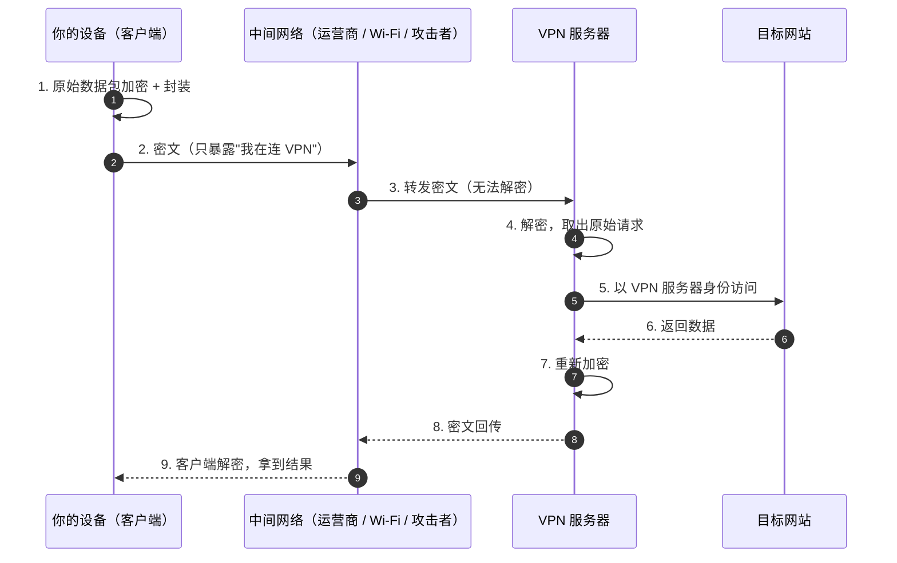
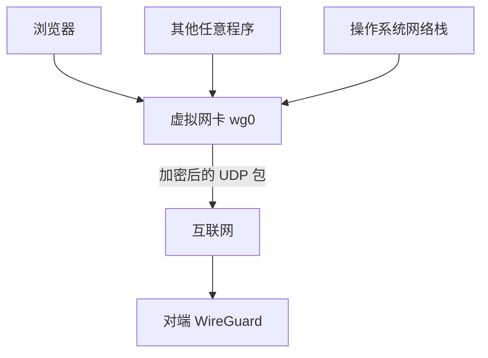
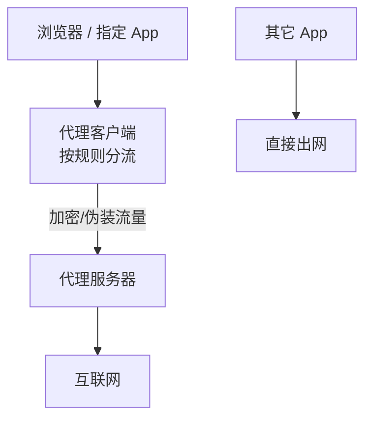

# 01 · VPN 基本原理：把数据装进一条加密隧道

> 本文是实验开始前整理的原理笔记，目的是先搞清楚「数据包到底经过了什么」，再去动手配置。

## 1. 一句话定义

**VPN（Virtual Private Network，虚拟专用网络）** 是在公共网络（互联网）之上，用加密与封装技术"虚拟"出来的一条专用通道。它让两台相隔万里的机器，看起来像处在同一个内网里。

关键点在于**两层同时成立**：

- **隧道（Tunneling）**：把原始数据包整个包装进一个新的数据包里传输；
- **加密（Encryption）**：隧道里传输的内容，中间任何一跳都看不懂。

## 2. 没有 VPN 时，数据是怎样暴露的

即使启用了 HTTPS，中间网络依然能看到：

- 你访问了**哪个 IP / 域名**（DNS 查询、SNI、目标地址）；
- 通信的**时间、频率、流量大小**（流量分析）；
- 如果你用了不安全的公共 Wi-Fi，还可能被中间人劫持（HTTPS 之外的部分）。

> 📦 **快递类比**：没有 VPN 就像直接寄快递，所有经手包裹的人都看得到面单上的收发件人和地址。VPN 相当于先把包裹塞进一个统一规格的密封箱，中途的转运中心只能看到"这个箱子从 A 发往中转站"。

## 3. 有 VPN 时，数据的旅程

由此得到三个直接效果：

| 效果 | 原因 |
| --- | --- |
| 中间网络看不到通信内容 | 全链路加密 |
| 网站看到的是 VPN 服务器的 IP | 服务器作为出口代理 |
| 公共 Wi-Fi 下的风险显著降低 | 本地链路已被密文包裹（对协议级攻击有效，但仍是"信任服务器"的模型） |

需要清醒认识的一点：**VPN 把信任从"中间网络"转移到了"VPN 服务端"**。所以你自建服务器，或者选择一个你信任的服务商，本质上是同一件事的两面。

## 4. VPN 的两大类实现

实验里最初没分清这两者，导致选型走了弯路。它们的差别是**工作层级**，而不是"谁更高级"：

### 4.1 操作系统级 VPN（WireGuard / OpenVPN）

开启后，系统里会凭空出现一块**虚拟网卡**（Linux 下的 `tun`/`tap` 设备）：

- 所有流量（浏览器、IM、音乐软件、系统更新）无条件被吸入这块虚拟网卡；
- 在**网络层（Layer 3）**统一加密打包；
- 因此是"全局接管"，天然支持任意协议和整机设备互通。

### 4.2 应用层代理协议（Shadowsocks / VLESS+Reality / SOCKS5）

不接管操作系统网络栈，而是让**客户端软件**把流量按规则交给远端：

- 支持**按域名/IP 分流**（国内直连、国外走代理），因此国内网站不减速；
- 流量特征可以伪装成普通 HTTPS（Reality 的核心卖点）；
- 只影响配置了代理的程序。

详细的协议对比见 [`02-protocol-comparison.md`](02-protocol-comparison.md)。

## 5. 加密与认证是怎么建立的

一次安全的隧道建立，至少要回答三个问题：**对面是不是真的？密钥怎么协商？数据怎么防篡改？**

- **对称加密**（如 `xchacha20-ietf-poly1305`、`ChaCha20-Poly1305`）：负责真正搬运数据，速度快；AEAD 模式同时提供加密与完整性校验。
- **非对称加密 / 密钥交换**（如 Curve25519、X25519、Noise 握手）：负责在不可信信道上协商出对称密钥；WireGuard 用的是公钥/私钥 + Noise IK 握手。
- **认证与抗重放**：WireGuard 用 shared key 之外的握手时间戳抗重放；TLS 体系则依赖**证书链 + PKI**验证服务端身份——这正是本次实验第一处翻车的地方（详见 [`05-xray-reality-postmortem.md`](05-xray-reality-postmortem.md)）。

## 6. 本次实验的落点

| 问题 | 本次实验的选择 |
| --- | --- |
| 用哪一类？ | 应用层代理（Shadowsocks-libev），因为只需要给特定设备/程序用，且配置面小、可验证 |
| 用什么加密？ | `xchacha20-ietf-poly1305`（AEAD，移动端性能友好） |
| 怎么验证生效？ | 对比代理前后的出口 IP + `ping` 链路质量，见 [`04-shadowsocks-deployment.md`](04-shadowsocks-deployment.md) |
| VPN 协议部分怎么补？ | 单独用 WireGuard 做原理对照实验，见 [`03-wireguard-deep-dive.md`](03-wireguard-deep-dive.md) |

## 7. 自检问题

如果你想确认自己真的理解了这一章，试着不看笔记回答：

1. VPN 和 HTTPS 都加密，为什么还需要 VPN？
2. 为什么说"VPN 是全局的，代理是局部的"？请从工作层级解释。
3. 中间人能看到的"你连接了 VPN"具体是什么信息？
4. VPN 服务端被攻破后，加密还保护你吗？
