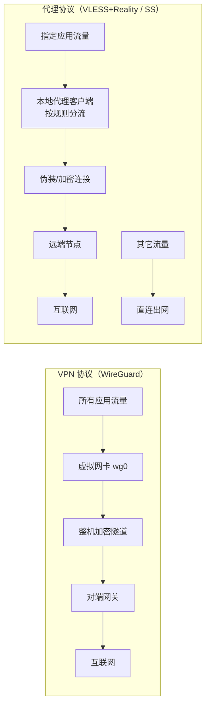

# 02 · 现代 VPN 协议 vs 代理协议

> 选型前整理的对比笔记。实验最初的错误就在于：**把"抗封锁能力"当成了唯一指标**，结果选了一条自己当时还 hold 不住的路。

## 1. 对比总表

| 特性 | 现代 VPN 协议（如 WireGuard） | 代理协议（如 VLESS / Reality） |
| --- | --- | --- |
| 出生目的 | 保护内网安全、防止数据被窃听（**数据保密**） | 穿透网络限制、绕过审查（**流量伪装**） |
| 工作层级 | 操作系统底层（网络层 / 虚拟网卡），默认强制全局 | 应用层（客户端软件内），支持按域名/IP 智能分流 |
| 流量特征 | 具有明显的 VPN 握手特征，容易被识别 | 可伪装成标准 HTTPS 流量，隐蔽性高 |
| 核心优势 | 绝对安全、支持所有软件、断线重连极快 | 隐蔽性极高、国内网站不减速、抗封锁能力强 |
| 适用场景 | 远程办公连公司内网、在外连接家里 NAS | 跨国访问、按需分流的个人网络加速 |
| 配置复杂度 | 低（一份配置文件 + 一对密钥） | 中～高（证书 / TLS / 伪装参数 / 分流规则） |
| 排障难度 | 低（`wg show` 一眼看穿握手状态） | 高（多层：网络 → TLS → 伪装参数 → 客户端兼容性） |

## 2. 两种模型的结构差异

- **VPN = 一条管道**：管道里的东西它不管，但**全都要走管道**。
- **代理 = 一个调度员**：它认识"目的地"，所以能**挑着走**，但也因此更容易在应用层暴露特征。

## 3. 本项目涉及的三条技术路线

| 路线 | 类型 | 加密/伪装 | 本次结果 | 复盘 |
| --- | --- | --- | --- | --- |
| WireGuard | VPN 协议 | Noise IK + ChaCha20-Poly1305，UDP | 仅做原理与配置实验 | [`03`](03-wireguard-deep-dive.md) |
| Xray + VLESS + Reality | 代理协议 | 借用真实站点的 TLS 指纹，无自签证书 | ❌ 未跑通（TLS / 参数 / 配置污染 / 双实例） | [`05`](05-xray-reality-postmortem.md) |
| Shadowsocks-libev | 代理协议 | AEAD（`xchacha20-ietf-poly1305`） | ✅ 一次连通并验证 | [`04`](04-shadowsocks-deployment.md) |

## 4. 选型时的判断框架

不要问"哪个最强"，要问下面四个问题：

1. **我要保护的是什么？**
   - 保护"整机所有流量、不被窃听" → VPN 协议；
   - 保护"部分流量、绕开可达性问题" → 代理协议。

2. **我的对手/环境是谁？**
   - 只是在公共 Wi-Fi 下防止被嗅探 → WireGuard 足够；
   - 需要对抗深度包检测（DPI）→ 才轮到 Reality 这类伪装协议。

3. **我现在的运维能力能不能支撑它？**
   > 这是本次最大的教训。Reality 需要同时理解 TLS 证书链、X25519 密钥对、shortId、客户端指纹兼容性，任何一环出错的表现都是同一句"连接超时"。
   > **选一个你能排障的方案，而不是一个你只能照抄的方案。**

4. **成本收益比是多少？**
   - 排障投入（时间 × 剩余不确定性） vs 换方案的沉没成本。
   - 当"继续排障"的期望收益低于"换一条已知可行的路"时，果断切换。

## 5. 术语速查

| 术语 | 含义 |
| --- | --- |
| AEAD | Authenticated Encryption with Associated Data，同时保证机密性与完整性 |
| TUN / TAP | 操作系统虚拟网卡，分别是三层（IP）与二层（以太网）设备 |
| NAT / MASQUERADE | 出口地址转换，让内网流量借用服务器公网 IP 出网 |
| VLESS | Xray 的一种轻量无状态传输协议 |
| Reality | 不依赖自签证书、直接"借用"真实网站 TLS 握手特征的伪装方案 |
| shortId | Reality 用于区分/授权客户端的一个短标识 |
| SNI | TLS 握手中的目标域名，中间网络可见 |
| 分流（Routing） | 按域名/IP/地区规则决定哪些流量走代理、哪些直连 |

## 6. 延伸阅读

- WireGuard 白皮书与官网：<https://www.wireguard.com/papers/wireguard.pdf>
- Xray-core 文档（VLESS / Reality）：<https://xtls.github.io/>
- Shadowsocks 协议规范（SIP002 / AEAD）：<https://shadowsocks.org/>
