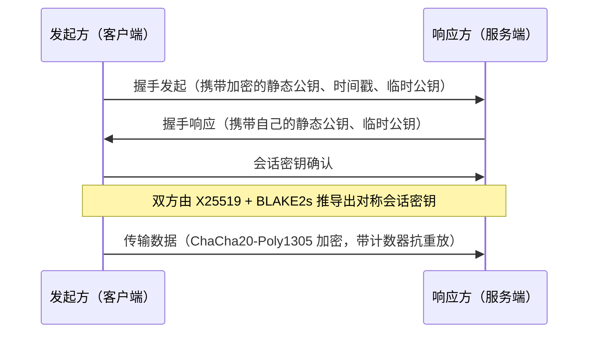

# 03 · WireGuard 原理与最小可用部署

> 这条线是**原理对照实验**：即使最终生产用的是代理协议，也要亲手把 VPN 协议跑一遍，才能说清楚"虚拟网卡"到底是什么感觉。

## 1. 它为什么又小又快

WireGuard 的核心设计哲学：**把复杂性从代码里挪到密码学原语里**。

| 设计 | 带来的结果 |
| --- | --- |
| 代码量小（内核态实现，约数千行量级） | 攻击面小、容易审计 |
| 只支持固定的一组现代密码学原语（Curve25519 / ChaCha20 / Poly1305 / BLAKE2s） | 没有"协商降级"的空间，也不会选到弱算法 |
| 基于 UDP，无连接状态 | 断线重连快、移动网络切换无感 |
| 用公钥直接表示对端（Cryptokey Routing） | 不需要证书体系，配置就是"密钥 + 允许的网段" |
| 静默设计（不响应未认证的包） | 端口扫描基本扫不出来 |

### 1.1 握手：Noise IK 的直观理解



三个要点：

1. **双方身份由静态公钥确定**，没有证书、没有 CA；
2. **每次握手都会生成临时密钥（前向保密）**，即使静态私钥将来泄露，也解不开历史流量；
3. **时间戳参与握手**，重放旧握手包无效——这也是为什么服务器时钟严重跑偏会导致"连不上"。

### 1.2 路由：`AllowedIPs` 是"路由表 + 访问控制表"

`AllowedIPs` 一个字段干了两件事：

- **出站路由**：发往这些网段的流量走这个 peer；
- **入站过滤**：来自这个 peer 的包，源地址必须落在这些网段内，否则丢弃。

```ini
# 服务端视角
[Peer]
PublicKey = <客户端公钥>
AllowedIPs = 10.8.0.2/32      # 只允许这个客户端使用它自己的隧道 IP

# 客户端视角（全局代理）
[Peer]
PublicKey = <服务端公钥>
Endpoint  = <服务器IP>:51820
AllowedIPs = 0.0.0.0/0, ::/0  # 所有流量都走隧道
```

## 2. 最小可用部署（Debian / Ubuntu）

> 也可以直接执行 [`scripts/03-install-wireguard.sh`](../scripts/03-install-wireguard.sh)，它把下面这些步骤做成了幂等脚本。

### 步骤 1：准备服务器并安装

```bash
sudo apt update
sudo apt install -y wireguard wireguard-tools
```

### 步骤 2：生成密钥对

```bash
umask 077                                   # 关键：确保私钥文件权限是 600
wg genkey | tee server_private.key | wg pubkey > server_public.key
wg genkey | tee client_private.key | wg pubkey > client_public.key
```

> 私钥 = 身份。它在 WireGuard 里相当于"账号 + 密码 + 证书"三合一，泄露等于把内网钥匙交出去。

### 步骤 3：服务端配置 `/etc/wireguard/wg0.conf`

```ini
[Interface]
Address    = 10.8.0.1/24         # 服务端在隧道内的地址
ListenPort = 51820               # 可自定义
PrivateKey = <server_private.key 的内容>

# 开启转发与 NAT，让客户端能借服务器出网
PostUp   = iptables -A FORWARD -i %i -j ACCEPT; iptables -t nat -A POSTROUTING -o eth0 -j MASQUERADE
PostDown = iptables -D FORWARD -i %i -j ACCEPT; iptables -t nat -D POSTROUTING -o eth0 -j MASQUERADE
# 注意：eth0 要换成本机真实的出口网卡名（用 `ip route get 1.1.1.1` 确认）

[Peer]
PublicKey  = <client_public.key 的内容>
AllowedIPs = 10.8.0.2/32
```

同时打开内核转发：

```bash
echo 'net.ipv4.ip_forward=1' | sudo tee /etc/sysctl.d/99-wireguard.conf
sudo sysctl --system
```

### 步骤 4：启动并设为开机自启

```bash
sudo systemctl enable --now wg-quick@wg0
sudo systemctl status wg-quick@wg0        # 看 active (exited) / 是否有报错
sudo wg show                              # 看 peer 的 latest handshake / transfer
```

### 步骤 5：客户端配置

```ini
[Interface]
PrivateKey = <client_private.key 的内容>
Address    = 10.8.0.2/24
DNS        = 1.1.1.1

[Peer]
PublicKey           = <server_public.key 的内容>
Endpoint            = <服务器公网IP>:51820
AllowedIPs          = 0.0.0.0/0, ::/0
PersistentKeepalive = 25        # 客户端在 NAT 后面时保活
```

导入 WireGuard 官方客户端（Windows / macOS / iOS / Android）即可。

### 步骤 6：验证

```bash
sudo wg show                      # latest handshake 有值 = 握手成功
ping -c 4 10.8.0.1                # 隧道内连通性
curl -s https://ipinfo.io/ip      # 出口 IP 应变为服务器 IP
```

## 3. 常见坑（与本次代理实验互相对照）

| 现象 | 常见原因 | 定位命令 |
| --- | --- | --- |
| 完全没反应、`wg show` 无 handshake | 端口没放行 / 防火墙拦 UDP / Endpoint 写错 | `sudo ss -lunp \| grep 51820`、`nc -vuz <ip> 51820` |
| 能握手但上不了网 | `AllowedIPs` 或 NAT 规则问题、`ip_forward` 未开 | `ip route`、`sudo iptables -t nat -L -n -v` |
| 握手反复掉线 | 服务器时钟偏移过大 / 客户端 NAT 超时 | `timedatectl`、加 `PersistentKeepalive` |
| 隧道通了但 DNS 不解析 | 客户端 `DNS=` 未设置或 DNS 泄漏 | `cat /etc/resolv.conf`、[`04-verify-connectivity.sh`](../scripts/04-verify-connectivity.sh) |

## 4. 和代理协议的取舍回顾

| 需求 | 推荐 |
| --- | --- |
| 整机流量保护、访问内网资源（NAS / 家用服务器） | WireGuard |
| 只需要部分应用走远端、要求国内访问不减速 | 代理协议（SS / VLESS） |
| 需要对抗 DPI 且你具备排障能力 | Reality 类伪装协议（务必先读 [`05`](05-xray-reality-postmortem.md)） |
