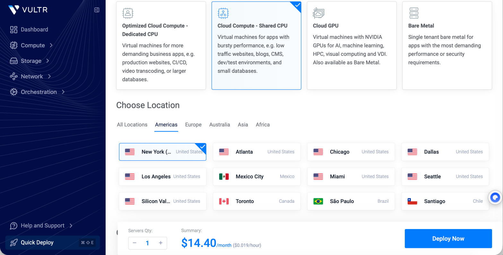
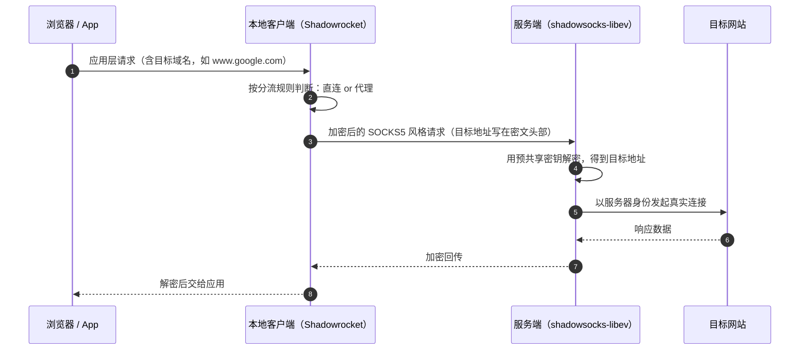

# 04 · 成功路线：Shadowsocks-libev 部署与验证

> 这是本次实验**最终跑通**的方案。相比上一轮的 Xray + Reality，它的配置面小得多，所有环节都可以被单独验证。

## 1. 实验环境

| 项目 | 内容 |
| --- | --- |
| 操作系统 | Debian 11 x64（Vultr VPS，美国节点） |
| 代理软件 | Shadowsocks-libev（服务端）+ Shadowrocket（macOS 客户端） |
| SSH 工具 | macOS Terminal |
| 网络 | IPv4 |
| 加密方式 | `xchacha20-ietf-poly1305` |

| 部署前 | 部署后 |
| --- | --- |
|  |  |

## 2. 原理速览：Shadowsocks 到底做了什么

Shadowsocks 是**加密代理协议**，不是操作系统级 VPN：



要点：

- **没有握手协商、没有证书**：客户端和服务端共用同一份密钥（`password` + `method`），先到先解。
- 因此它**不需要** TLS 证书链，也就绕开了本次第一轮最大的坑。
- 代价是：抗主动探测能力弱于 Reality 类协议，且流量特征相对固定。

## 3. 部署步骤（可完整复现）

> 自动化版本：[`scripts/02-install-shadowsocks.sh`](../scripts/02-install-shadowsocks.sh)

### 3.1 准备服务器并登录

```bash
ssh root@<服务器IP>            # 建议改为密钥登录，见 docs/07
```

先确认基础环境：

```bash
cat /etc/os-release            # 确认是 Debian 11
uname -m                       # x86_64
```

### 3.2 安装 Shadowsocks-libev

本次实验使用的是社区一键脚本（原脚本来源：[shadowsocks-all.sh](https://github.com/shadowsocks/shadowsocks-libev) 生态中的 teddysun 版）：

```bash
wget --no-check-certificate -O shadowsocks-all.sh \
  https://raw.githubusercontent.com/zhaoweih/Shadowsocks-Tutorial/main/sh/shadowsocks-all.sh
chmod +x shadowsocks-all.sh
./shadowsocks-all.sh 2>&1 | tee shadowsocks-all.log
```

脚本交互项与本次选择：

| 提问 | 选择 |
| --- | --- |
| 服务端版本 | Shadowsocks-libev |
| 登录密码 | 自定义（本次由脚本生成，**不在仓库中出现**） |
| 端口 | 自定义（1–65535，避免使用 22 / 443 等常用端口） |
| 加密方式 | `xchacha20-ietf-poly1305` |

> 💡 更可控的做法是直接用发行版仓库安装，避免"一键脚本黑盒"：
> ```bash
> sudo apt update && sudo apt install -y shadowsocks-libev
> ```
> 然后手写 `/etc/shadowsocks-libev/config.json`（见 [`configs/shadowsocks-server.json.example`](../configs/shadowsocks-server.json.example)）。

安装成功输出（IP / 端口 / 密码 / `ss://` 链接已打码）：


### 3.3 服务状态检查

```bash
systemctl status shadowsocks-libev --no-pager
sudo ss -tlnp | grep -E 'ss-server|8388'     # 确认端口在监听
sudo journalctl -u shadowsocks-libev -n 30 --no-pager   # 有任何报错先在这里看
```

### 3.4 防火墙放行

```bash
sudo ufw allow <端口>/tcp
sudo ufw allow <端口>/udp
sudo ufw status numbered
```

> 若云服务商（Vultr）另有安全组/防火墙面板，需要**两处都放行**——这是很常见的"服务正常但连不上"的原因。

## 4. 客户端配置（macOS · Shadowrocket）

配置项与服务器端必须**逐字一致**：

| 字段 | 值 |
| --- | --- |
| 类型 | Shadowsocks |
| 服务器 | 云服务器公网 IP |
| 端口 | 与 `config.json` 一致 |
| 密码 | 与 `config.json` 一致 |
| 加密方式 | `xchacha20-ietf-poly1305` |
| 路由 | 全局路由 / 按规则分流 |

也可以直接导入脚本生成的 `ss://` 分享链接（SIP002 格式，`base64(method:password)@host:port#备注`）。本仓库提供了生成脚本：

```bash
./scripts/ss-uri.py --host <服务器IP> --port <端口> \
  --method xchacha20-ietf-poly1305 --password '<你的密码>' --tag 'vps-node'
```

节点列表截图（同时可以看到第一轮遗留的 3 个 VLESS 节点，两个显示"超时"——它们正是失败路线的产物）：


## 5. 结果验证（两步交叉验证）

### 5.1 连通性验证

- 客户端开关打开后，能正常访问互联网，网络通信正常，状态显示已连接。

### 5.2 出口 IP 验证

访问 <https://ipinfo.io> 或 <https://whatismyipaddress.com>：

| 字段 | 结果 |
| --- | --- |
| IPv4 | Supported |
| ISP / IP Organization | Vultr |
| ASN | AS20473（The Constant Company, LLC） |
| Location | 美国（复盘时间线中记为 Los Angeles） |


**结论**：出口 IP 已由本地 ISP 变为服务器节点 IP，说明代理链路生效、流量确实经由服务器转发。

### 5.3 链路质量（为什么"能连上"不等于"好用"）

```bash
ping -c 20 <服务器IP>
```

本次结果：RTT 约 **170–260 ms**，`ttl=48`，23 个包中 **2 次超时**（约 8.7% 丢包）。


解读：

- 跨国链路 RTT 200 ms 上下属于正常范围（受物理距离 + 路由跳数影响）；
- 偶发超时更可能是**链路抖动**或**ICMP 限速**，而不一定是链路故障；
- 想区分二者，应该用 TCP 层的连续测量（如 `mtr`、`curl -w`）交叉验证，而不是只看 ping。

一键复现以上验证：

```bash
./scripts/04-verify-connectivity.sh --expect-node vultr
```

## 6. 本轮为什么能成（与上一轮的对照）

| 上一轮（Xray + Reality）的失败点 | 本轮如何规避 |
| --- | --- |
| TLS 证书链 / pinning 要求 | SS 不使用 TLS 证书，无此环节 |
| Reality 公私钥 / shortId 参数不匹配 | 只有"密码 + 加密方式"两个参数，人工可核对 |
| 手改 JSON 导致配置污染（中文引号等） | 配置极简，且脚本会做 JSON 语义校验 |
| v2ray-agent 自带 Xray 与手装 Xray 双实例冲突 | 单一来源安装，服务名唯一，`systemctl` 一查便知 |
| 排查靠"改配置试运气" | 每一步都有独立可验证的检查项（端口 / 日志 / 出口 IP） |

完整失败复盘见 [`05-xray-reality-postmortem.md`](05-xray-reality-postmortem.md)。

## 7. 后续可做（本仓库暂未实现）

- [ ] 用 `mtr` 长期采样，量化链路质量而不是只看单次 ping；
- [ ] 增加 `systemd` 定时任务，服务异常自动重启并记录日志；
- [ ] 用 Ansible 把 `scripts/` 里的步骤声明式化，支持多节点；
- [ ] 加入监控告警（服务端口探测 + 出口 IP 探测）。
