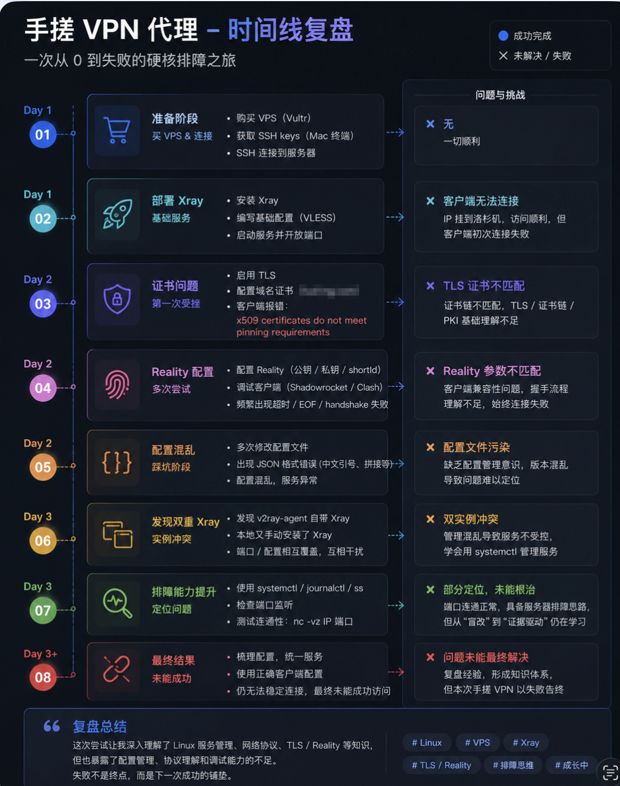
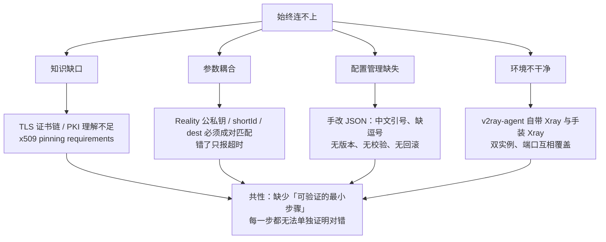

# 05 · 失败复盘：Xray + VLESS + Reality 的 8 个阶段

> **本次实验最有价值的部分。** 这条路线最终没有跑通，但每一步的现象、我的误判和真正的根因，比一次顺利的成功更能说明问题。



## 0. 背景与目标

- **目标**：搭一个具备"流量伪装"能力的代理节点，思路是业内公认抗封锁能力强的 **VLESS + Reality**。
- **环境**：Vultr VPS（Debian 11）+ macOS 客户端（Shadowrocket / Clash Verge）。
- **结果**：**连续三天未跑通**，最终判定"继续排障的期望收益 < 换方案的收益"，放弃该路线。

## 1. 时间线：8 个阶段

### Day 1 · 阶段 ① 准备阶段 — ✅ 顺利

| 项 | 内容 |
| --- | --- |
| 动作 | 购买 VPS（Vultr）→ 获取 SSH keys（Mac 终端）→ SSH 登录服务器 |
| 现象 | 一切顺利 |
| 说明 | 这一阶段的顺利给了错误的信心：**"能登录服务器"和"能配好服务"是两件事** |

### Day 1 · 阶段 ② 部署 Xray 基础服务 — ❌ 客户端无法连接

| 项 | 内容 |
| --- | --- |
| 动作 | 安装 Xray、编写 VLESS 基础配置、启动服务并开放端口 |
| 现象 | 服务端看起来正常，出口可达；**客户端首次连接失败** |
| 当时的误判 | 以为是客户端配置写错了 |
| 后来的理解 | 此时服务端"运行中"只说明进程活着，**不代表配置语义正确**。应该先用 `ss -tlnp` 确认端口监听、用 `journalctl -u xray` 确认没有启动告警，再谈客户端 |

### Day 2 · 阶段 ③ 证书问题（第一次受挫）— ❌ TLS 证书不匹配

| 项 | 内容 |
| --- | --- |
| 动作 | 启用 TLS、配置域名证书、客户端导入 |
| 现象 | 客户端报错：`x509 certificates do not meet pinning requirements` |
| 根因分析 | 证书链不被客户端信任 / 使用了自签证书 / 证书与域名不匹配。**当时我并不真正理解"证书链"和"pinning"是什么**，所以只能反复重签，属于典型的知识缺口型故障 |
| 教训 | 看到 TLS 报错，先分清三类问题：①证书本身无效 ②链路不信任（缺中间证书）③客户端校验策略过严。三者的修法完全不同 |
| 后续 | 正因为这一步卡住，才转向"不需要自签证书"的 Reality |

### Day 2 · 阶段 ④ Reality 配置（多次尝试）— ❌ 参数不匹配

| 项 | 内容 |
| --- | --- |
| 动作 | 配置 Reality（公钥 / 私钥 / shortId），调试客户端（Shadowrocket / Clash），修改配置并重新加载 |
| 现象 | 频繁超时、EOF、`handshake failure`，始终连接失败 |
| 根因分析 | Reality 的参数是**成对耦合**的：服务端私钥 ↔ 客户端公钥、shortId ↔ 客户端 shortId、dest/SNI ↔ 客户端伪装域名。任意一项错位，客户端都只表现为"超时"，**错误信息不指向真正的错点** |
| 教训 | 参数耦合度高的方案，必须有**配置来源单一化**（生成即写入、由脚本分发），否则人工搬运一定出错 |

### Day 2 · 阶段 ⑤ 配置混乱（踩坑加深）— ❌ 配置污染

| 项 | 内容 |
| --- | --- |
| 动作 | 多次手改配置文件 |
| 现象 | **JSON 语法错误**（中文引号 `“”`、字符串拼接、缺少逗号），配置混乱、服务异常 |
| 根因分析 | 在终端里手写/粘贴 JSON，输入法自动把英文引号转成中文引号，肉眼几乎看不出来 |
| 教训 | ①配置必须经过 `jq .` 或 `python -m json.tool` **语义校验**后再重启服务；②版本化，改前备份，改坏了能回滚；③不要在线上直接改，用模板渲染 |

### Day 3 · 阶段 ⑥ 发现双重 Xray 实例 — ❌ 双实例冲突

| 项 | 内容 |
| --- | --- |
| 动作 | 排查服务状态，发现 **v2ray-agent 自带 Xray**，而本地又手动安装了一份 Xray |
| 现象 | 端口 / 配置互相覆盖，两个服务互相干扰，行为不可预测 |
| 根因分析 | 安装脚本会自带一套运行时；再手动装一份，就出现了两个可执行文件、两套配置目录、两个 systemd 单元 |
| 教训 | **先查清楚系统里已经有什么**（`which -a xray`、`systemctl list-units | grep -i xray`、`ss -tlnp`），再决定装什么。单一来源原则 |

### Day 3 · 阶段 ⑦ 排障能力提升 — ⚠️ 部分定位，未能根治

| 项 | 内容 |
| --- | --- |
| 动作 | 使用 `systemctl` / `journalctl` / `ss` 检查服务；用 `nc -vz <ip> <port>` 测试端口连通性 |
| 结果 | 确认**端口连通正常**，服务器侧具备排障思路；但问题仍未定位到根因 |
| 收获 | 这是本次实验**方法论的转折点**：从"改配置试运气"转向"先收集证据，再下结论" |
| 不足 | 仍然停留在"能证明哪里是通的"，还没有做到"能证明哪里是坏的"（缺少对照实验、缺少抓包验证） |

### Day 3+ · 阶段 ⑧ 最终结果 — ❌ 未能成功

| 项 | 内容 |
| --- | --- |
| 动作 | 梳理配置、统一服务、使用正确的客户端配置 |
| 现象 | **仍无法稳定连接，最终未能成功访问** |
| 决策 | 判定继续投入的成本过高，**放弃该技术路线**，重新设计方案 |

## 2. 根因归类：四类问题，一个共性



**共性结论**：所有表现都是同一句"连接超时"，但故障点分别落在 TLS 层、参数层、配置层、进程层。
**当每一层都不可单独验证时，排障就退化为随机搜索。**

而 Shadowsocks 之所以一次成功，不是因为它"更简单"，而是因为**它的每一层都能单独验证**：

```bash
ss -tlnp | grep ss-server        # 进程/端口对不对
journalctl -u shadowsocks-libev  # 服务有没有报错
nc -vz <ip> <port>               # 网络通不通
curl -x socks5h://127.0.0.1:1080 https://ipinfo.io/ip   # 代理链路通不通
```

## 3. 决策点：为什么"放弃"是正确的选择

| 维度 | 继续排障 | 换方案（Shadowsocks） |
| --- | --- | --- |
| 剩余不确定性 | 高（4 类问题可能还有叠加） | 低（只有密码/端口/加密方式三项） |
| 所需知识 | TLS/PKI + Reality 协议细节 + Xray 内部机制 | TCP + 一个 JSON 配置 |
| 预期再来一轮能否成功 | 不确定 | 大概率一次成功（事实确实如此） |
| 沉没成本 | 3 天 | — |

> **沉没成本不是继续投入的理由。** 判断标准应该是"从现在开始，哪条路更快到达可用的结果"。

## 4. 如果重来一次：我的检查清单

1. **装之前先看现场**：`which -a xray`、`systemctl list-units --type=service | grep -iE 'xray|v2ray'`、`ss -tlnp`。
2. **单一来源**：只用一种方式安装，装完立刻记录版本与配置路径。
3. **配置即代码**：所有配置进 Git（本地/私有仓库），改前 `cp` 备份，改后 `python -m json.tool` 校验。
4. **分层验证**，每层单独给出"通过/失败"结论：

   | 层 | 验证命令 | 期望 |
   | --- | --- | --- |
   | 进程 | `systemctl is-active xray` | `active` |
   | 端口 | `ss -tlnp \| grep <port>` | 有 LISTEN |
   | 网络 | `nc -vz <server_ip> <port>` | `succeeded` |
   | TLS | `openssl s_client -connect <host>:<port> -servername <sni>` | 证书链完整、校验通过 |
   | 应用 | 客户端日志 / 服务端 `journalctl -f` 同步观察 | 有对应记录 |
5. **服务端 + 客户端日志同时看**：只盯一边，永远只能看到"半个故事"。
6. **一次只改一个变量**，并记录改动前后现象。

## 5. 补充：失败路线留下的配置骨架

即使没跑通，配置骨架依然有学习价值，已脱敏保存在
[`configs/xray-vless-reality.json.example`](../configs/xray-vless-reality.json.example) 与
[`configs/clash-verge-reality.yaml.example`](../configs/clash-verge-reality.yaml.example)，
其中的参数耦合关系注释在 [`docs/06`](06-troubleshooting-playbook.md) 的错误对照表里。

## 6. 诚实记录

> 这份复盘刻意保留了"当时我以为是 X，后来发现是 Y"的认知过程。
> 一次失败的真实价值，不在于最后总结出几句正确的道理，而在于**能说清楚自己是在哪一步开始想错的**。
