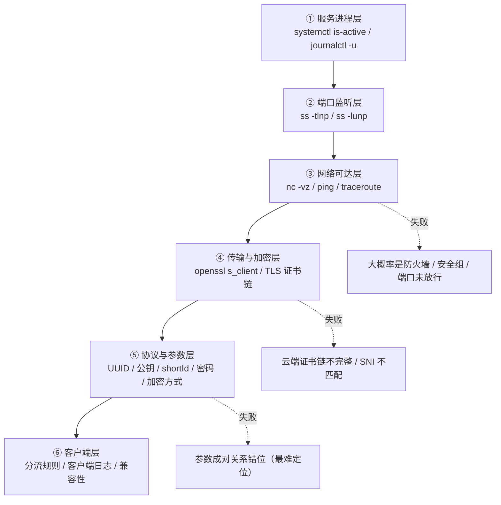

# 06 · 排障手册：从「盲改配置」到「证据驱动」

> 本手册是本次实验的直接产物。核心只有一句话：**先分层定位，再改配置。**

## 1. 分层定位法

任何"连不上"，都先沿着这条链自下而上走一遍，每层给出明确的通过/失败结论，**不要跳层猜**：



### 每层的标准动作

| 层 | 命令 | 通过标准 |
| --- | --- | --- |
| ① 进程 | `systemctl is-active <svc>`；`journalctl -u <svc> -n 50 --no-pager` | `active`，日志无 error |
| ② 端口 | `sudo ss -tlnp \| grep <port>` / `sudo ss -lunp \| grep <port>` | 存在 LISTEN |
| ③ 网络 | `nc -vz <ip> <port>`（TCP）/ `nc -vuz <ip> <port>`（UDP） | `succeeded` |
| ④ 加密 | `openssl s_client -connect <host>:<port> -servername <sni>` | 证书链完整、`Verify return code: 0 (ok)` |
| ⑤ 参数 | 逐字段比对服务端与客户端 | 每个键值完全相同 |
| ⑥ 客户端 | 客户端日志 + 服务端 `journalctl -f` 同步观察 | 两端都能看到同一次连接的记录 |

> ⚠️ 只看一端日志，永远只能看到"半个故事"。**服务端开着 `journalctl -f`，再点客户端连接**，是最有效的技巧之一。

## 2. 本次实验的错误对照表

| 报错 / 现象 | 我当时的猜测 | 真正的可能原因 | 一步验证 |
| --- | --- | --- | --- |
| `x509 certificates do not meet pinning requirements` | "证书没生效，重签一次" | ①证书链不完整（缺中间证书）②SNI/域名与证书不匹配 ③客户端校验策略严格 | `openssl s_client -connect host:443 -servername <域名>` 看证书链 |
| `handshake failure` | "客户端版本太老" | Reality 参数不匹配 / 伪装目标（dest）不可用 / shortId 错位 | 服务端与客户端逐字段对照 + 双端日志 |
| `connection timeout` | "服务器挂了" | 端口未放行（云端安全组 + 本机防火墙**两处**）/ 服务未监听 | `ss -tlnp` + `nc -vz` |
| `EOF` / 连接建立后立刻断开 | "被墙了" | 服务端进程异常退出 / 配置语义错误导致启动即崩 | `systemctl status` + `journalctl -u` |
| 服务显示 active 但客户端连不上 | "服务正常，那一定是网络问题" | 进程活着 ≠ 配置正确；可能是**双实例**互相覆盖端口 | `ps -ef \| grep -iE 'xray\|v2ray'` 看有几个进程 |
| JSON 解析失败 | "配置我写得没错" | 输入法把 `"` 变成了 `“”`（中文引号）；缺逗号 | `python3 -m json.tool < config.json` |
| 改了配置毫无变化 | "缓存问题" | 服务没重载（只改了文件没 restart）/ 改的是另一个实例的配置文件 | `systemctl restart` + 确认配置文件真实路径 |

## 3. 配置管理规范（本次踩坑后固化）

1. **单一来源**：一个服务只用一个配置文件、一个安装来源。装之前先 `which -a`、`systemctl list-units`。
2. **配置即代码**：
   ```bash
   cp config.json config.json.bak.$(date +%F-%H%M%S)   # 改前备份
   python3 -m json.tool < config.json > /dev/null       # 改后校验
   systemctl restart <svc> && systemctl status <svc> --no-pager
   ```
3. **不在终端里手写 JSON**：用模板渲染（`envsubst` / 脚本），或者写完立刻用编辑器格式化。
4. **一次只改一个变量**：同时改三处，等于放弃定位能力。
5. **记录改动日志**：时间 / 改了什么 / 现象变化。

## 4. 凭据与密钥卫生

| 对象 | 建议 |
| --- | --- |
| SSH | 密钥登录，禁用密码与 root 直登，见 [`07`](07-security-and-compliance.md) |
| 代理密码 / UUID | 随机生成（≥16 字符），定期轮换，不进 Git |
| WireGuard 私钥 | `umask 077` + `wg genkey`，权限 600 |
| `ss://` 分享链接 | 内含 IP+端口+密码，**等同于密码**，禁止截图外发（本次截图中已做像素化） |
| 截图 | 发布前对 IP / 端口 / 密码 / UUID / 域名 / 用户名统一打码 |

本仓库的 [`scripts/`](../scripts/) 全部遵循"凭据只从参数或随机数来"的原则，`.github/workflows/ci.yml` 中还有一道**敏感信息扫描**，防止误提交私钥或硬编码公网 IP。

## 5. 常用命令速查

```bash
# 服务与日志
systemctl status <svc> --no-pager
systemctl restart <svc> && journalctl -u <svc> -f
journalctl -u <svc> --since "10 min ago"

# 端口与进程
sudo ss -tlnp          # TCP 监听
sudo ss -lunp          # UDP 监听
ps -ef | grep -iE 'xray|v2ray|ss-server|wireguard'

# 连通性与链路
nc -vz <ip> <port>
mtr -rwzbc 50 <ip>
curl -s --max-time 8 https://ipinfo.io/json | jq '{ip, city, org}'

# 代理链路验证（以本地 SOCKS5 端口 1080 为例）
curl -x socks5h://127.0.0.1:1080 -s https://ipinfo.io/ip
curl -x http://127.0.0.1:8080  -s https://ipinfo.io/ip

# TLS 检查
openssl s_client -connect <host>:<port> -servername <sni> -showcerts </dev/null 2>&1 | head -40

# 配置校验
python3 -m json.tool < config.json
```

## 6. 心态与流程

| 反模式 | 替代做法 |
| --- | --- |
| "先改了再说" | 先写下预期现象，再改，再看是否吻合 |
| "重装一次说不定就好了" | 重装会掩盖根因；先查现场，再决定是否重装 |
| "教程这么写肯定对" | 教程假设的环境和你的现场一定不同（版本、已有服务、防火墙） |
| "报错了就搜报错" | 搜之前先判断报错属于上面哪一层——**搜索词的质量取决于你对问题的定位** |
