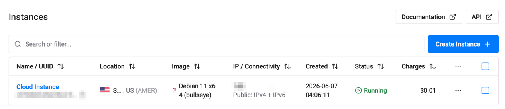
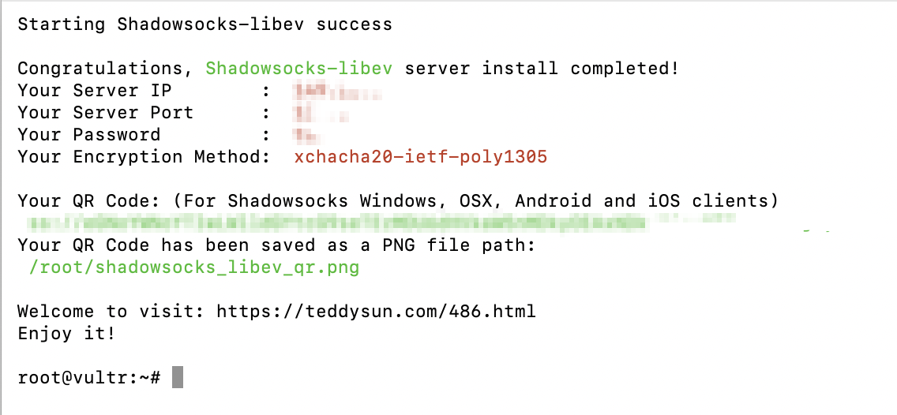
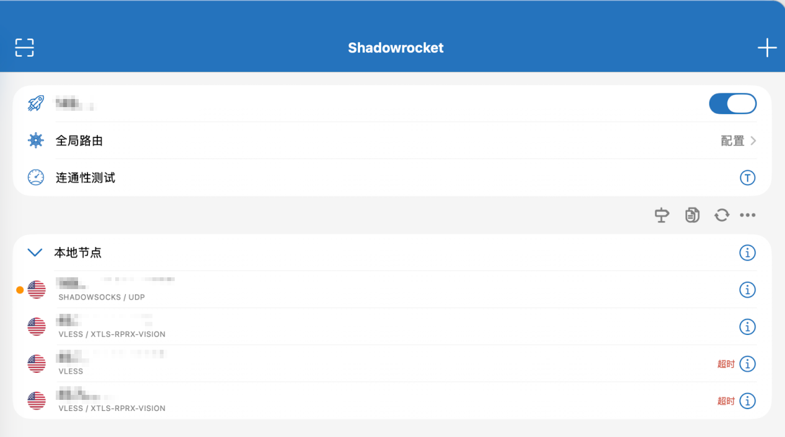
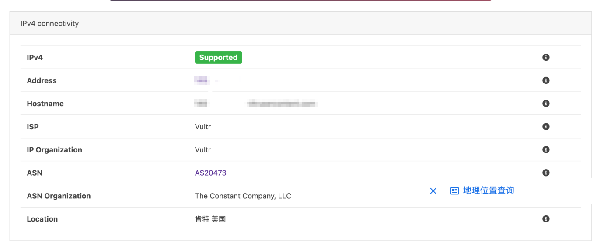
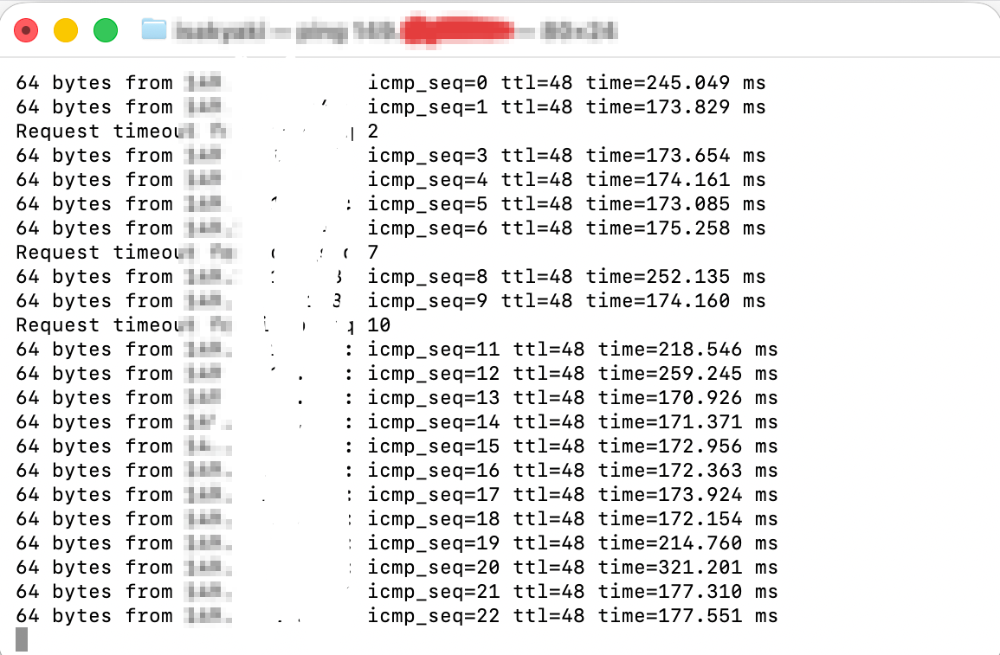

# 08 · 实验报告正文（脱敏归档版）

> 本文是原始实验报告的 Markdown 归档版。**所有 IP、端口、密码、UUID、域名与个人信息均已脱敏**，内容结构保持与原报告一致。

---

## 一、实验名称

**VPN 代理搭建与原理分析实验**

## 二、实验目的

1. 理解 VPN（Virtual Private Network，虚拟专用网络）的基本工作原理；
2. 学习 VPN 的加密通信机制；
3. 掌握代理服务（Shadowsocks）的部署与配置方法；
4. 完成客户端与服务器之间的安全通信；
5. 学会验证代理/VPN 是否正常工作。

## 三、实验环境

| 项目 | 内容 |
| --- | --- |
| 操作系统 | Debian 11 x64 |
| 代理软件 | Shadowsocks（服务端 shadowsocks-libev）/ Shadowrocket（客户端） |
| 云服务器 | Vultr |
| 客户端设备 | macOS |
| 网络环境 | IPv4 |
| SSH 工具 | macOS Terminal |

## 四、实验原理

### 4.1 VPN 的基本概念

VPN 是一种在公共网络上建立"加密隧道"的技术。用户的数据不会直接发送到目标网站，而是：

1. 先加密；
2. 发送到 VPN 服务器；
3. VPN 服务器代替用户访问互联网；
4. 再将数据返回给用户。

这样可以实现：数据加密、隐藏真实 IP、安全远程访问、提高公共 Wi-Fi 下的安全性。

### 4.2 VPN 工作流程

```text
客户端 → 加密数据 → VPN 隧道 → VPN 服务器 → 目标网站
目标网站 → VPN 服务器 → 加密返回 → 客户端
```

因此：

- 中间网络只能看到"你连接了 VPN"；
- 无法直接看到通信内容；
- 网站看到的是 VPN 服务器 IP。

> 现代网络信息传输就像顺丰发包裹：没有 VPN 时，所有经手包裹的人都能看到面单信息；VPN 开启后，相当于通过中转站保护传输信息。

### 4.3 现代 VPN 协议和代理协议（proxy）

现代 VPN 协议的核心代表是 **WireGuard** 和 **OpenVPN**，工作原理是操作系统级的"虚拟网卡"：

- 开启现代 VPN（如 WireGuard）后，系统会创建一个虚拟网卡（TUN/TAP 设备）；
- **全局掌控**：只要系统有流量要出去（浏览器、IM、音乐软件、系统更新），都会无条件被吸入这块虚拟网卡；
- **网络层加密**：无论访问网页（HTTP）还是发邮件（SMTP），统统打包，在网络层（Layer 3）统一加密。

WireGuard 的特点：

- 代码量小、配置简单、性能高；
- 使用现代密码学算法、延迟低；
- 使用公钥/私钥认证、UDP 通信、加密隧道技术，实现安全的数据传输。

**VPN 协议与代理协议对比（原报告表）**

| 特性 | 现代 VPN 协议（如 WireGuard） | 代理协议（如 VLESS / Reality） |
| --- | --- | --- |
| 出生目的 | 保护公司内网安全、防止数据被窃听（数据保密） | 穿透防火墙、绕过网络审查（流量伪装） |
| 工作层级 | 操作系统底层（网络层 / 虚拟网卡），默认强制全局 | 应用层（软件内），支持智能按域名/IP 分流 |
| 流量特征 | 具有明显的 VPN 握手特征，极易被识别 | 完美伪装成标准 HTTPS 流量，真假难辨 |
| 核心优势 | 绝对安全、支持所有软件、断线重连极快 | 隐蔽性极高、国内网站不减速、抗封锁能力强 |
| 适用场景 | 远程办公连公司内网、在外连接家里 NAS | 科学上网、跨国网络加速 |

## 五、实验步骤

### 5.1 准备服务器

购买一台 Linux 云服务器。实验中服务器信息如下（已脱敏）：

| 项目 | 内容 |
| --- | --- |
| 服务器 IP | `<SERVER_IP>`（原报告：149.28.*.*） |
| 系统版本 | Debian 11 x64 |
| SSH 工具 | macOS Terminal |

成功连接服务器截图（实例 ID 与 IP 已打码）：



### 5.2 在 mac 终端中安装 Shadowsocks

使用 `ssh root@<服务器IP>` 接入服务器。

### 5.3 使用安装脚本

```bash
wget --no-check-certificate -O shadowsocks-all.sh https://raw.githubusercontent.com/zhaoweih/Shadowsocks-Tutorial/main/sh/shadowsocks-all.sh
chmod +x shadowsocks-all.sh
./shadowsocks-all.sh 2>&1 | tee shadowsocks-all.log
```

选择 Shadowsocks 服务器端版本，输入登录密码、端口号，选择加密方式。

### 5.4 获取配置

安装脚本直接输出配置信息，无需手工编写配置文件（`ss://` 链接已打码）：



### 5.5 配置客户端

客户端配置示例（见 [`configs/`](../configs/)）：类型 Shadowsocks，填入服务器 IP、端口、密码、加密方式，选择全局路由或按规则分流。

## 六、实验结果

### 6.1 连接测试

连接成功后：能正常访问互联网，网络通信正常，客户端状态显示已连接。



### 6.2 IP 地址测试

访问 `ipinfo.io`、`whatismyipaddress.com`，发现 IP 已变为服务器 IP，说明代理已成功转发网络流量。



链路质量补充测量（`ping` RTT ≈ 170–260 ms，23 包中 2 次超时）：



## 七、实验分析

实验中学习了：

1. VPN 的加密隧道原理；
2. 公钥/私钥认证机制；
3. Linux 网络配置；
4. 客户端与服务端通信流程。

WireGuard 相较传统 VPN：配置更简单、性能更高、延迟更低。但同时也需要注意：

- **私钥安全**；
- **防火墙配置**；
- **服务器安全**。

此外，本次实验还完整经历了一次失败的技术路线（Xray + VLESS + Reality），详见 [`05-xray-reality-postmortem.md`](05-xray-reality-postmortem.md)。

## 八、失败路线的复盘（原报告"复盘之前的失败实验尝试"）

| 阶段 | 动作 | 结果 |
| --- | --- | --- |
| ① VPS | 购买 Vultr VPS（Ubuntu）、SSH 登录服务器 | ✓ |
| ② Reality Route | 部署 Xray、配置 VLESS + Reality、生成 UUID / PublicKey / PrivateKey | ✓ |
| ③ Client Configuration | 手动编写 YAML、导入 Clash Verge、配置 Reality 节点 | ✓ |
| ④ Failure Loop | 节点超时、TLS 验证失败、Xray 配置冲突、服务重复安装、SSH 连接中断、Reality 与客户端兼容问题 | ✗ |
| ⑤ Decision Point | 判定继续排障成本过高，放弃第一条技术路线 | ⚠ |
| ⑥ Rebuild | 重新部署 VPS、寻找更简单的方案、采用 Shadowsocks | ✓ |
| ⑦ Success | 导入订阅链接、客户端连接成功、IP 变为美国节点、可正常访问 | ✓ |

**Lessons Learned（原报告）**：Linux、SSH、Systemd、Xray、TLS、Reality、Proxy Protocols、Troubleshooting。

**Final Result**：第一次硬核排障 —— 失败；第二次重新设计方案 —— 成功。

## 九、实验总结

本实验成功实现了：

- 代理服务端搭建；
- 客户端接入；
- 通信测试（连通性 + 出口 IP 双向验证）。

通过实验加深了对 VPN 工作原理和网络安全技术的理解，同时掌握了 Linux 下网络服务部署的基本方法，为后续学习网络安全和服务器运维提供了实践基础。

## 十、参考资料

1. WireGuard 官方文档
2. Linux 网络配置文档
3. Ubuntu Server / Debian 官方文档
4. VPN 网络通信原理相关资料
